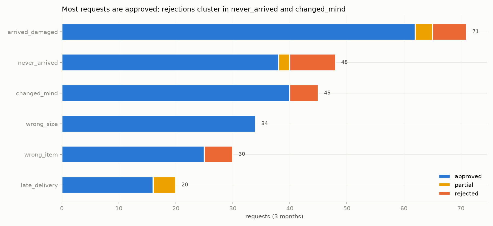
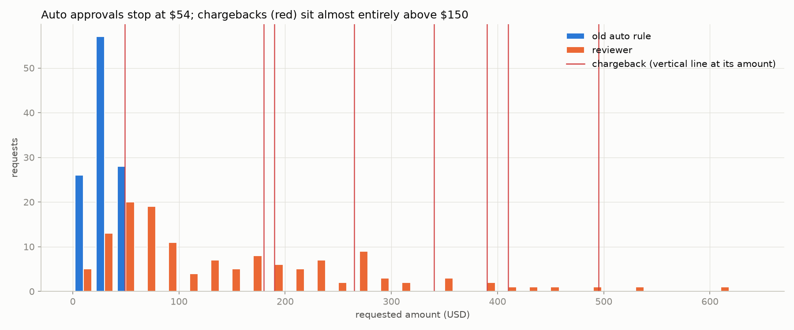
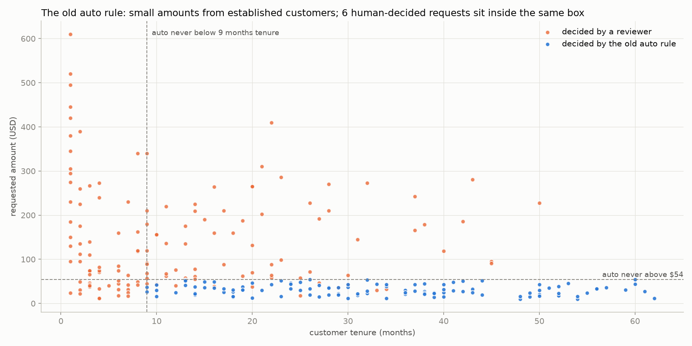
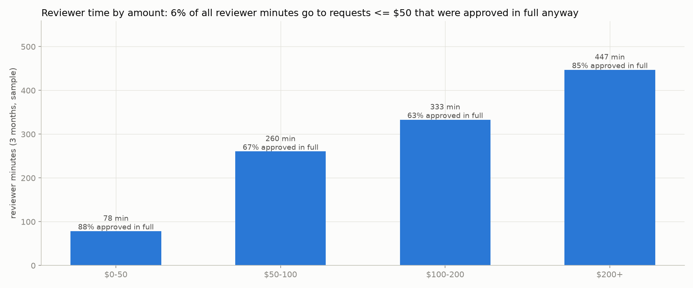
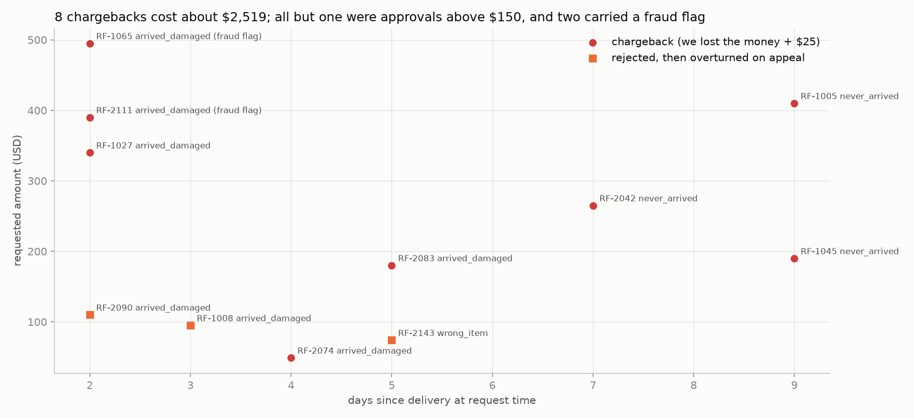

# EDA findings

Generated by `python scripts/eda.py` from `data/history.csv` and `data/pending.csv`. All numbers below are computed, not typed.

## 1. Data quality

history.csv: 251 rows. pending.csv: 21 rows. Counts of rows that depart from the data dictionary (fixed by `normalize_requests`):

| issue | history | pending |
|---|---|---|
| duplicate_request_id | 3 | 1 |
| duplicate_request_id_conflicting | 0 | 1 |
| amount_unparseable | 0 | 0 |
| amount_whitespace | 3 | 0 |
| fraud_flag_nonstandard | 9 | 2 |
| missing_fraud_flag | 1 | 1 |
| reason_alias | 6 | 1 |
| category_case | 2 | 0 |
| missing_tenure | 2 | 0 |
| missing_days_since_delivery | 1 | 0 |
| missing_customer_id | 1 | 0 |
| pii_in_notes | 1 | 0 |
| date_nonstandard | 8 | 1 |

Notes: duplicate ids are dropped keeping the first row. The pending duplicate (RF-2183) has two different amounts, so whichever is kept, a person should look at it. Fraud flag variants (`Y`, `N`, `false`, blank) are mapped to yes/no; a blank stays unknown and is never treated as 'no'.

## 2. Volume: what comes in and who decides



| stated_reason | approved | partial | rejected | total |
|---|---|---|---|---|
| arrived_damaged | 62 | 3 | 6 | 71 |
| never_arrived | 38 | 2 | 8 | 48 |
| changed_mind | 40 | 0 | 5 | 45 |
| wrong_size | 34 | 0 | 0 | 34 |
| wrong_item | 25 | 0 | 5 | 30 |
| late_delivery | 16 | 4 | 0 | 20 |

By decider (requests, dollars requested, approved count):

| decided_by | requests | dollars | approved |
|---|---|---|---|
| D. Patel | 28 | 3,711.4 | 22 |
| J. Alvarez | 24 | 3,880.9 | 19 |
| R. Mizrahi | 40 | 5,425.4 | 33 |
| S. Kwan | 45 | 6,996.8 | 30 |
| auto | 111 | 3,377.1 | 111 |

The existing auto rule decides **111 of 248 requests (45%)** but only **14% of the dollars**. Everything else is read by one of four reviewers.



## 3. The old auto rule, reverse-engineered

Nobody remembers the logic, so here it is from the data. Every auto-decided request satisfies all of:

- amount <= **$54**
- prior refunds in 12 months <= **0**
- tenure >= **9 months**
- fraud flag not yes (values seen: False, None)
- any stated reason (arrived_damaged, changed_mind, late_delivery, never_arrived, wrong_item, wrong_size)
- every one of the 111 was **approved** in full



**6 requests decided by humans also fit inside that box.** Their outcomes: {'approved': 3, 'rejected': 3}. Why they were not auto-decided is not in the data; the pattern below (most of them carry a note) suggests the old rule skips anything with free text, or routes by source. Either way these are candidates for automation:

| stated_reason | has_note | count |
|---|---|---|
| arrived_damaged | True | 1 |
| changed_mind | True | 5 |

A further **22 small requests (<= $54, no prior refunds) came from customers with under 9 months tenure** and so fell outside the old rule; outcomes: {'approved': 21, 'rejected': 1}. Tenure is the main reason small requests still reach a reviewer.

## 4. Where reviewer time goes



| decided_by | requests | mean_min | total_min |
|---|---|---|---|
| D. Patel | 28 | 6.9 | 192.0 |
| J. Alvarez | 24 | 8.9 | 213.0 |
| R. Mizrahi | 40 | 9.0 | 360.5 |
| S. Kwan | 45 | 7.9 | 353.5 |

| band | requests | total_min | approved_full | approved_full_share |
|---|---|---|---|---|
| $0-50 | 32 | 78.5 | 28 | 88% |
| $50-100 | 36 | 260.5 | 24 | 67% |
| $100-200 | 30 | 333.0 | 19 | 63% |
| $200+ | 39 | 447.0 | 33 | 85% |

Total reviewer time in the sample: **1119 minutes** over 137 requests (mean 8.2 min). **28 requests <= $50 were approved in full after a human read them**, costing 72 minutes (6% of all reviewer time). That is the 'two minutes clicking approve' from the brief.

## 5. Bad outcomes: what went wrong after the decision



| request_id | amount_usd | stated_reason | decision | decided_by | fraud_flag | days_since_delivery | kind | outcome_note |
|---|---|---|---|---|---|---|---|---|
| RF-1005 | 410.0 | never_arrived | approved | S. Kwan | False | 9 | chargeback | chargeback filed 2026-07-11 |
| RF-2042 | 265.0 | never_arrived | approved | S. Kwan | False | 7 | chargeback | chargeback filed 2026-07-22 |
| RF-1027 | 340.0 | arrived_damaged | approved | R. Mizrahi | False | 2 | chargeback | chargeback filed 2026-08-03 |
| RF-2074 | 49.0 | arrived_damaged | approved | auto | False | 4 | chargeback | chargeback filed 2026-08-06 |
| RF-2083 | 180.0 | arrived_damaged | approved | S. Kwan | False | 5 | chargeback | chargeback filed 2026-08-14 |
| RF-1045 | 190.0 | never_arrived | approved | S. Kwan | False | 9 | chargeback | chargeback filed 2026-08-19 |
| RF-2111 | 390.0 | arrived_damaged | approved | R. Mizrahi | True | 2 | chargeback | chargeback filed 2026-08-28 |
| RF-1065 | 495.0 | arrived_damaged | approved | S. Kwan | True | 2 | chargeback | chargeback filed 2026-09-05 |
| RF-1008 | 95.0 | arrived_damaged | rejected | S. Kwan | False | 3 | overturned | outside policy per reviewer; customer appealed 2026-06-15 - overturned, refunded in full |
| RF-2090 | 110.0 | arrived_damaged | rejected | S. Kwan | False | 2 | overturned | customer appealed - overturned, refunded in full; customer closed account |
| RF-2143 | 74.0 | wrong_item | rejected | D. Patel | False | 5 | overturned | customer escalated - warehouse confirmed mis-pick; refunded on appeal |

**8 chargebacks**, total exposure about **$2,519** (order amounts $2,319 plus $25 fee each). 1 of them was auto-approved; 2 had a fraud flag and were approved by a reviewer anyway. Chargeback rate on approvals: 3.7% overall, 0.9% on auto approvals.

## 6. Decisions that look wrong against the manager's own policy

(For context: 11 fraud-flagged requests were approved *after* the fraud team confirmed a stolen card. Those follow policy note 5 and are not listed.)

**approved with fraud flag yes and NO fraud-team confirmation (policy 5 says the fraud team decides): 3**

| request_id | amount_usd | decided_by | days_since_delivery | support_note | outcome_note |
|---|---|---|---|---|---|
| RF-1014 | 185.0 | S. Kwan | 7 | Brand-new account, shipping address doesn't match the billing address on the card. |  |
| RF-2111 | 390.0 | R. Mizrahi | 2 | New account, first order; no photos despite two requests. | chargeback filed 2026-08-28 |
| RF-1065 | 495.0 | S. Kwan | 2 | New account, no previous orders, first purchase is a $495 item. Says it arrived broken, no photos yet. | chargeback filed 2026-09-05 |

**approved changed_mind after 14 days (policy: no exceptions): 4**

| request_id | amount_usd | decided_by | days_since_delivery | support_note | outcome_note |
|---|---|---|---|---|---|
| RF-2012 | 39.0 | R. Mizrahi | 18 |  |  |
| RF-2055 | 44.0 | R. Mizrahi | 21 |  |  |
| RF-1034 | 40.0 | R. Mizrahi | 25 |  |  |
| RF-2105 | 61.0 | R. Mizrahi | 27 |  |  |

**approved arrived_damaged over $50 with no mention of a photo: 9**

| request_id | amount_usd | decided_by | days_since_delivery | support_note | outcome_note |
|---|---|---|---|---|---|
| RF-2023 | 64.0 | R. Mizrahi | 3 |  |  |
| RF-2037 | 52.0 | auto | 5 |  |  |
| RF-2046 | 53.0 | auto | 1 |  |  |
| RF-1033 | 88.0 | J. Alvarez | 4 | 3rd one this week from the same supplier batch, all missing the power cable - QA ticket #4471. |  |
| RF-2083 | 180.0 | S. Kwan | 5 | Customer admitted on chat she'd assembled it herself and it snapped. | chargeback filed 2026-08-14 |
| RF-1039 | 340.0 | D. Patel | 2 | Fourth claim from this customer this quarter, every one 'broken on arrival'. |  |
| RF-1047 | 310.0 | D. Patel | 2 | Outer box pristine, foam insert intact, screen shattered from the inside? Doesn't add up - possibly damaged after delivery. |  |
| RF-2121 | 51.3 | auto | 6 |  |  |
| RF-2168 | 140.0 | D. Patel | 3 | video received - flicker visible |  |

**approved never_arrived where the carrier had proof of delivery: 2**

| request_id | amount_usd | decided_by | days_since_delivery | support_note | outcome_note |
|---|---|---|---|---|---|
| RF-1005 | 410.0 | S. Kwan | 9 | Carrier POD shows it signed for at 11:02 by 'M. Katz'. Customer says nobody by that name lives there. | chargeback filed 2026-07-11 |
| RF-2042 | 265.0 | S. Kwan | 7 | Tracking shows delivered and signed; customer says the signature isn't hers. | chargeback filed 2026-07-22 |

**rejected then overturned on appeal: 3**

| request_id | amount_usd | decided_by | days_since_delivery | support_note | outcome_note |
|---|---|---|---|---|---|
| RF-1008 | 95.0 | S. Kwan | 3 | photos clear | outside policy per reviewer; customer appealed 2026-06-15 - overturned, refunded in full |
| RF-2090 | 110.0 | S. Kwan | 2 | photos clear | customer appealed - overturned, refunded in full; customer closed account |
| RF-2143 | 74.0 | D. Patel | 5 |  | customer escalated - warehouse confirmed mis-pick; refunded on appeal |

**fraud flag missing (blank): 1**

| request_id | amount_usd | decided_by | days_since_delivery | support_note | outcome_note |
|---|---|---|---|---|---|
| RF-2134 | 19.2 | auto | 7 |  |  |


## 7. What the free text carries (why an LLM reader earns its place)

history: 205 of 248 requests have a note (135 customer, 148 support). pending: 17 of 20.

Policy notes 3, 4, 5 and 6 depend on things that exist only in these notes: a photo, carrier proof, an open investigation, a confirmed stolen card, a confirmed picking error. Distinct support-note phrases, grouped by the fact they imply (keyword match, for orientation only):

- **photo attached / received** (16 distinct phrases): "Carrier has a signature on file and a photo of the parcel at the front door."; "Dent is on the outer carton only; contents fine per photos."; "New account, first order; no photos despite two requests."; "New account, no previous orders, first purchase is a $495 item. Says it arrived broken, no photos yet."; "No photo - customer says she already threw the box and the unit away."; "Photos clear - crack runs from the corner, box crushed on the same side."; "Photos show liquid damage on the board - not a transit issue."; "Photos show the original packaging still sealed, no transit damage on the box. Customer says unit is completely dead." ...
- **carrier proof of delivery (signature, locker, delivery photo)** (6 distinct phrases): "Carrier POD shows it signed for at 11:02 by 'M. Katz'. Customer says nobody by that name lives there."; "Carrier has a signature on file and a photo of the parcel at the front door."; "Delivered to parcel locker, customer collected it per locker log."; "Signed for at the door, carrier photo shows the parcel on the step."; "Tracking shows delivered and signed; customer says the signature isn't hers."; "Tracking shows delivered, signed 'K. Levi'. Customer says no one by that name at the address."
- **carrier trace / investigation / tracking stuck** (9 distinct phrases): "Last scan Northfield sort centre 10 days ago; carrier ticket opened."; "Last scan: Northfield DC on 08/08. Carrier not answering."; "Stuck at NFD hub since 08/16."; "Stuck at Northfield hub - last scan 6 days ago."; "Tracking stops at the regional depot, carrier has opened a trace."; "tracking inconclusive - last scan 10 days ago"; "tracking stops at depot"; "tracking stops at depot (NFD)" ...
- **card reported stolen / fraud confirmed** (7 distinct phrases): "Card reported stolen. Order not recognised by the account holder."; "Card was stolen per cardholder; she never placed this order."; "Cardholder called her bank - card was stolen, she never placed this order."; "Cardholder called the bank - says she never placed this order. Fraud team confirmed card was stolen."; "Unauthorised purchase per cardholder - bank fraud case opened."; "Unauthorised transaction per the cardholder - card reported stolen to the bank."; "card reported stolen"
- **our mistake confirmed (picking error, wrong item sent)** (5 distinct phrases): "Warehouse confirms mis-pick, same SKU family."; "confirmed picking error"; "matches order line"; "matches order line - customer may be mistaken"; "matches order line - customer ordered this model"

The PII found in customer notes (card digits, phone numbers) is redacted by `normalize_requests` before anything reaches a model or a log.

## 8. The line: backtest of the policy on history

Generated by `refund-agent backtest` (with note facts). Policy v1, cap in force: $200.

```
Backtest of policy v1 on 248 historical requests (11.1 weeks)
  auto-approved         120  (48%)   $5,015.13
  expected per week    $450.08 auto-approved (baseline for the rollback trigger)
  reviewer minutes     saved 156, still needed 963
  agreement            100% of auto-approvals were also approved by the final human decision
  overpaid on partials $0.00
  bad auto-approvals, detectable (a note or flag was there to read):
    none
  bad auto-approvals, undetectable (nothing in the request could have caught it):
    YELLOW RF-2074  $49.00  rule=damaged_small  chargeback
  still routed to people, by rule:
      26  over_cap
      24  default_route
      19  fraud_flag_to_fraud_team
      19  never_arrived_needs_carrier_check
      18  late_delivery_partial_call
       9  changed_mind_outside_window
       6  new_account
       4  repeat_refunder
       2  tenure_unknown
       1  fraud_check_missing
VERDICT: PASS
LLM calls: 0 (173 cache hits), spend $0.0000, $0.00000 per call, $0.00000 per decision over 248 requests
```

If the auto-approve cap were:

| cap | auto-approved | rate | dollars | reviewer minutes saved | bad (detectable) | bad (undetectable) |
|---|---|---|---|---|---|---|
| $54 | 104 | 42% | $3,130 | 48 | 0 | 1 |
| $60 | 107 | 43% | $3,301 | 56 | 0 | 1 |
| $80 | 108 | 44% | $3,372 | 59 | 0 | 1 |
| $100 | 111 | 45% | $3,639 | 86 | 0 | 1 |
| $150 | 115 | 46% | $4,140 | 104 | 0 | 1 |
| $200 | 120 | 48% | $5,015 | 156 | 0 | 1 |

**Bad** = the policy approves and the case later charged back, carried a fraud flag the fraud team did not confirm, or the final human decision (after appeals) was rejected or partial. **Detectable** = a note or a fraud flag was there to be read; those make the verdict FAIL. **Undetectable** = nothing in the request could have caught it; listed as accepted risk.

**Rollback after launch.** Tier 1: one chargeback or fraud confirmation on an auto-approved request, the manager disables the rule that fired. Tier 2: if the chargeback rate on auto-approvals over the trailing 4 weeks exceeds the historical human rate (3.7%), or one week's auto-approved dollars exceed 1.5x the expected per-week baseline above, the manager publishes a policy whose first rule is ALWAYS route.
